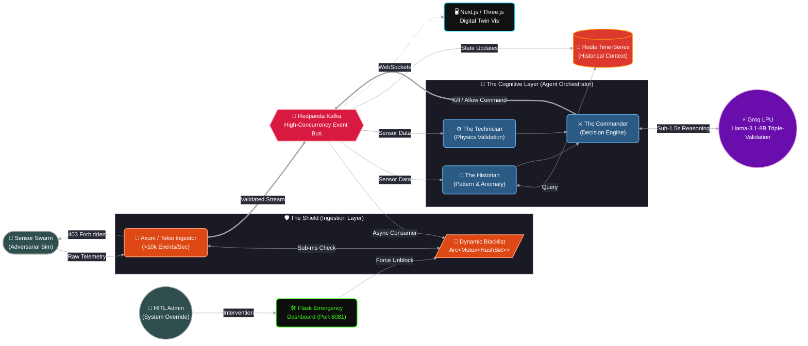

# NEXUS OS: Autonomous Multi-Agent Digital Twin & Governance 🌐🧠

[](https://www.rust-lang.org/)
[](https://www.python.org/)
[](https://groq.com/)
[](https://redpanda.com/)

NEXUS OS is a high-performance, **Level 4 Autonomous** system designed for smart city governance. It features a closed-loop "Observation -> Reasoning -> Action" cycle where real-time sensor streams are scrutinized by an **AI Expert Council** and secured by a distributed **Rust-powered Firewall**.


---

## 🏗️ System Architecture

NEXUS is built as a distributed, high-concurrency microservices ecosystem:

1.  **The Shield (Ingestion Layer - Rust):** - Built with **Axum** and **Tokio** for high-speed async ingestion.
    - Implements a **Dynamic Blacklist** using `Arc<Mutex<HashSet>>` for thread-safe, sub-millisecond firewall checks.
    - Background Kafka consumer listens for AI "Kill Signals" to update the firewall state in real-time.

2.  **The Nervous System (Redpanda):**
    - A Kafka-compatible event-streaming core handling data distribution between the Ingestor and the AI Brain.

3.  **The Cognitive Layer (Agent Orchestrator - Python):**
    - A multi-agent "Brain" utilizing **Llama-3.1-8B** to perform triple-validation:
        * **The Historian**: Analyzes **Redis** time-series data for pattern anomalies.
        * **The Technician**: Validates physical impossibility (e.g., values > 5.0).
        * **The Commander**: Issues `BLOCK` or `ALLOW` commands back to the Shield via Kafka.

4.  **The Manual Override (Emergency Dashboard):**
    - A **Flask** dashboard (Port 8081) allowing human-in-the-loop (HITL) intervention to unblock sensors.


---

## 🚀 Key Performance Indicators (KPIs)

| Metric | Target | Status |
| :--- | :--- | :--- |
| **Ingestion Throughput** | 10,000+ Events/Sec | 🟢 Optimized (Rust) |
| **Firewall Latency** | < 1ms | 🟢 Active (In-Memory) |
| **Agent Decision Latency** | < 1.5 Seconds | 🟢 Active (Groq LPU) |
| **System Uptime** | 99.9% (Simulated) | 🟢 Active |

---

## 📊 Strategic S.W.O.T. Analysis

### **Strengths**
- **Autonomous Governance:** Moves beyond dashboards; the system takes physical action (403 Forbidden) based on AI reasoning.
- **Apex Tech Stack:** Combines the safety/speed of Rust with the reasoning power of Llama-3.1.

### **Weaknesses**
- **Resource Intensive:** Significant RAM requirements for running Redpanda, Redis, and Rust-analyzer concurrently.

### **Opportunities**
- **Scalable Infrastructure:** Ready for global logistics or city-wide traffic management.

### **Threats**
- **Adversarial Spoofing:** Mitigated by the AI Technician agent verifying hardware limits.

---

## 🛠️ Setup & Execution

1. **Spin up Infrastructure**:
   ```bash
   cd infrastructure && docker-compose up -d
---

## 📂 Project Structure

```text
nexus-os/
├── backend/
│   ├── ingest-service/     # Rust: High-speed firewall & ingestion
│   ├── agent-orchestrator/ # Python: AI Expert Council logic
│   └── sensor-sim/         # Python: Adversarial data generator
├── infrastructure/         # Docker, Redis, Redpanda configs
└── frontend/               # Next.js/Three.js Visualization
